# CloudBSD

### The Sovereign Virtualization Platform Built on FreeBSD

High-density, resilient cluster virtualization engineered as an open enterprise hypervisor platform.

[cloudbsd.ai](https://cloudbsd.ai) · [cloudbsd.org](https://cloudbsd.org) · [Discord](https://discord.gg/8KYawCuG)

---

## The Vision

CloudBSD transforms FreeBSD into a cohesive, production-grade cluster virtualization platform designed to replace legacy enterprise hypervisor stacks. 

By combining the proven stability, security, and storage architecture of FreeBSD with autonomous AI-driven fleet management, CloudBSD delivers a complete operating ecosystem across bare metal, server appliances, and workstation environments.

## Core Pillars

- **Enterprise Cluster Virtualization** — High-density isolation with native FreeBSD Jails and high-performance Bhyve virtual machines, providing an open, resilient alternative to proprietary hypervisor clusters.
- **Unified Workload Runtime** — First-class support for virtual machines, jails, and OCI containers side-by-side on a shared, secure substrate.
- **ZFS Storage Fabric** — Native data integrity, instant point-in-time snapshots, built-in encryption, and continuous replication.
- **AI-Managed Fleet Operations** — Autonomous intelligence placed directly in front of cluster infrastructure to handle discovery, orchestration, diagnostics, and operational health.
- **Complete System Family** — Cohesive platforms spanning server infrastructure, appliances, and a tailored developer desktop.

## The Ecosystem

- **[cloudbsdai](https://github.com/cloudbsdai)** — Operational catalogues, inspection surfaces, and AI management layers ([cloudbsd.ai](https://cloudbsd.ai)).
- **[revytechinc](https://github.com/revytechinc)** & **[revytechai](https://github.com/revytechai)** — Enterprise deployment, hardened consulting, and engineering studio ([revytechinc.ai](https://revytechinc.ai) / [revytechinc.com](https://revytechinc.com)).

---

*Built on FreeBSD.*

